# Microservices Shop — Architecture & Design Document

> **System:** `ms_sap_project` — an e‑commerce "shop" reference platform built on a Spring Boot microservices backend, an Angular SPA frontend, and Keycloak-based OAuth2/OIDC security.
> **Author:** Software Architecture review • **Date:** 2026‑11‑08
> **Status:** Core request/response flows complete (pre‑Kafka). Event-driven notification layer is planned, not yet implemented.

---

## 1. Executive Summary

This project implements a classic **synchronous microservices** architecture for an online shop. A customer authenticates through **Keycloak**, browses products, and places orders. Every client request enters through a single **API Gateway** that handles routing, JWT validation (OAuth2 Resource Server), CORS, and resilience (circuit breakers). Three domain services sit behind the gateway:

| Service | Responsibility | Datastore |
|---|---|---|
| **product-service** | Product catalog (create, list) | MongoDB |
| **order-service** | Order placement & persistence | MySQL |
| **inventory-service** | Stock availability checks | MySQL |

The only **inter-service** call is `order-service → inventory-service` (synchronous REST via a declarative HTTP interface), protected by **Resilience4j** (circuit breaker + retry + time limiter) with a graceful fallback.

### Key architectural characteristics
- **Style:** Microservices, database-per-service, API-Gateway edge pattern.
- **Communication:** Synchronous HTTP/REST (JSON). No message broker yet (Kafka planned).
- **Security:** Centralized at the gateway — stateless JWT bearer tokens issued by Keycloak; the Angular app uses the OIDC Authorization Code + PKCE flow with silent refresh.
- **Resilience:** Circuit breakers at both the gateway (per-route) and in order-service (per inventory call), plus retry and timeout policies.
- **Observability:** Spring Boot Actuator + aggregated Swagger/OpenAPI docs exposed through the gateway.

---

## 2. Technology Stack

| Layer | Technology | Version |
|---|---|---|
| Frontend | Angular (standalone components), RxJS, Tailwind, `angular-auth-oidc-client` | Angular 18 |
| Backend runtime | Java | 21 |
| Framework | Spring Boot | 3.5.3 |
| Gateway | Spring Cloud Gateway (Server MVC) | Spring Cloud |
| Security | Spring Security OAuth2 Resource Server, Keycloak | Keycloak 24.0.1 |
| Resilience | Resilience4j (circuit breaker, retry, time limiter) | — |
| Persistence | Spring Data MongoDB (product), Spring Data JPA / Hibernate (order, inventory) | — |
| Databases | MongoDB 7.0.5, MySQL 5.7.44 (×2), MySQL 8 (Keycloak) | — |
| DB migrations | Flyway (declared in order & inventory) | — |
| API docs | springdoc-openapi (Swagger UI) | 2.8.9 |
| Testing | JUnit 5, Testcontainers, REST Assured, WireMock | — |
| Build | Maven (per service), Angular CLI | — |

---

## 3. System Context & Component Architecture

### 3.1 Component / Deployment diagram

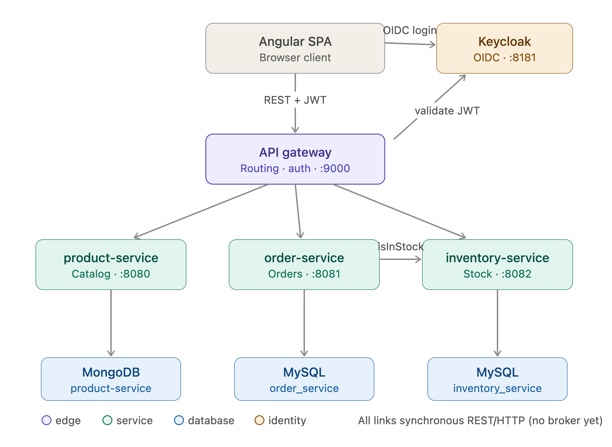

*Service-to-service communication: every link is synchronous REST/HTTP. The only direct service-to-service call is `order-service → inventory-service` (`isInStock`).*

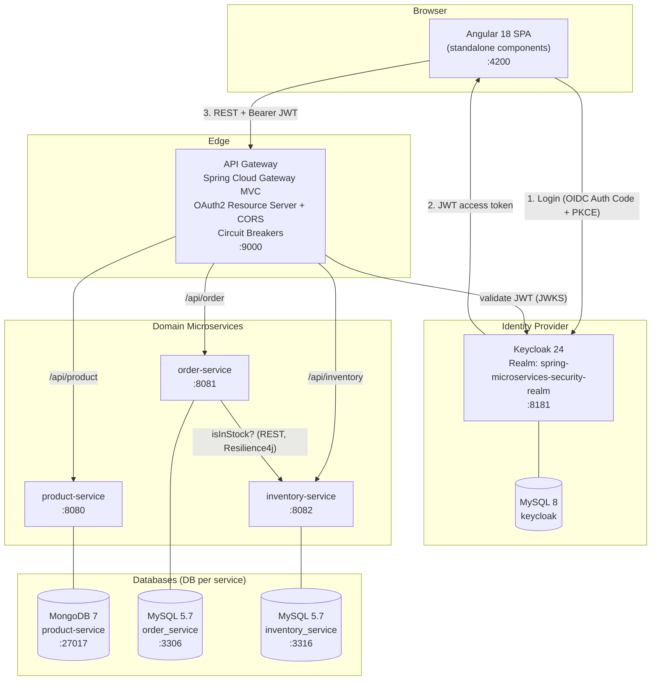

### 3.2 Routing & port map

| Route (gateway `:9000`) | Target service | Port | Notes |
|---|---|---|---|
| `POST/GET /api/product` | product-service | 8080 | Catalog |
| `POST /api/order` | order-service | 8081 | Place order |
| `GET /api/inventory` | inventory-service | 8082 | Stock check (also called internally by order-service) |
| `/aggregate/{svc}/v3/api-docs` | each service | — | Aggregated Swagger docs |
| `/fallbackRoute` | gateway | 9000 | `503` when a circuit opens |

All public routes except Swagger/aggregate resources require a valid JWT (`anyRequest().authenticated()`).

---

## 4. Request Flow — Flowchart

End-to-end flow of the two primary use cases (**browse/order** and **add product**), including the resilience branch.

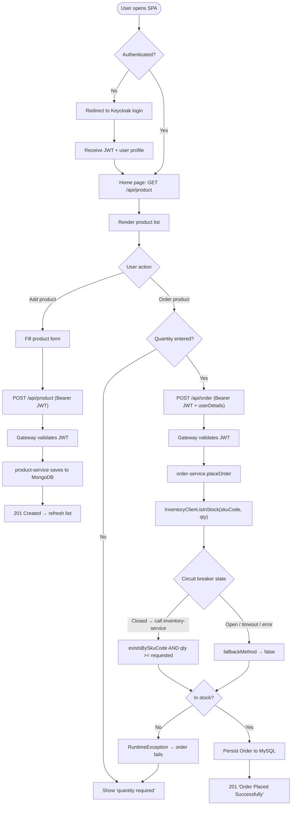

---

## 5. Data Architecture — ER Diagrams

Each service owns its own schema (**database-per-service**); there are **no cross-database foreign keys** — the link between an order and inventory is the business key **`skuCode`**, resolved at runtime via REST.

### 5.1 order-service — MySQL `order_service`

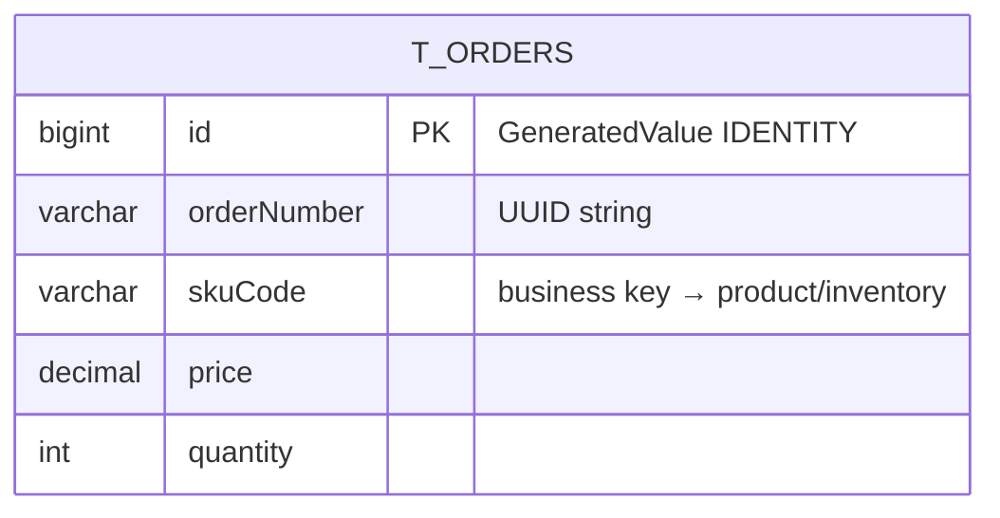

### 5.2 inventory-service — MySQL `inventory_service`

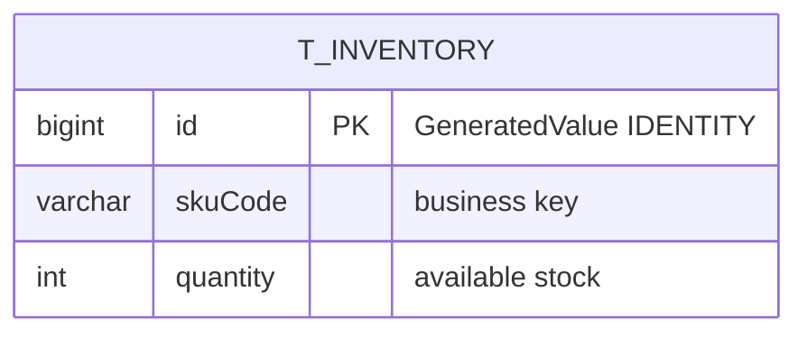

### 5.3 product-service — MongoDB `product-service` (collection `product`)

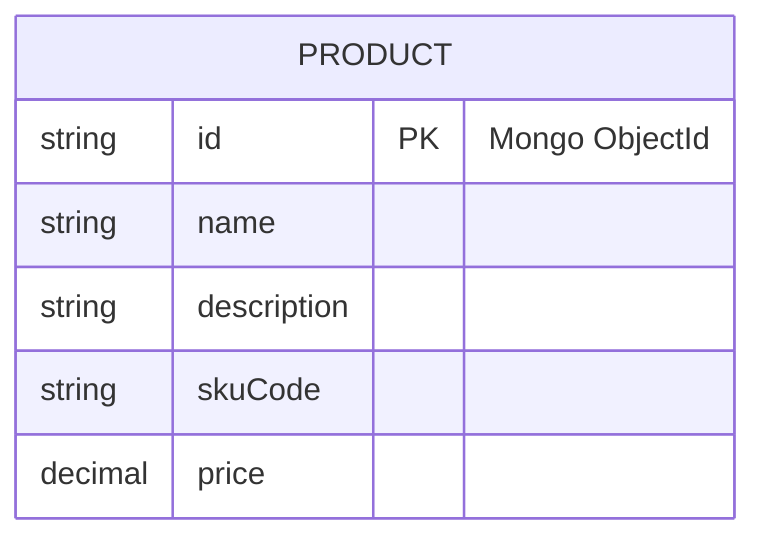

### 5.4 Logical relationships (cross-service, by `skuCode`)

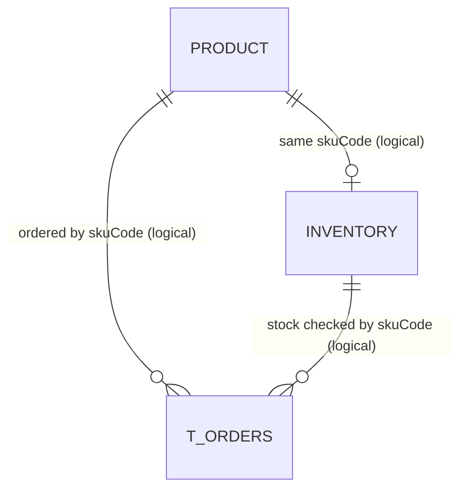

> **Design note:** `skuCode` is the integration contract across services but is **not enforced** by any constraint. Product creation does not seed an inventory row, so a product can exist with no stock record (and `isInStock` returns `false`). Keycloak maintains its own user store (MySQL 8) and is not modeled here.

---

## 6. UML — Class Diagram

Backend domain + application layers across the three services and the gateway.

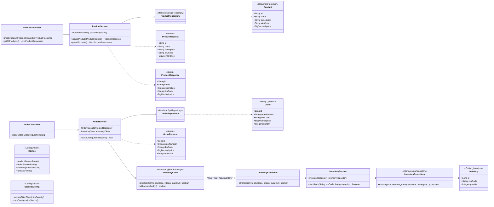

---

## 7. UML — Sequence Diagrams

### 7.1 Place Order (happy path + fallback)

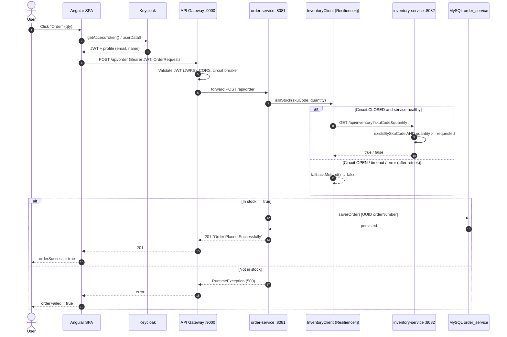

### 7.2 Create Product

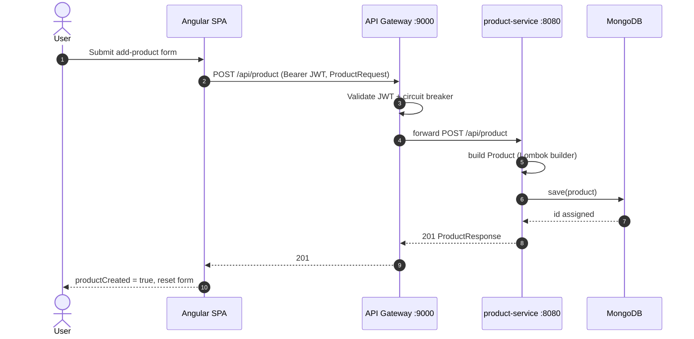

### 7.3 Authentication (OIDC Authorization Code + PKCE)

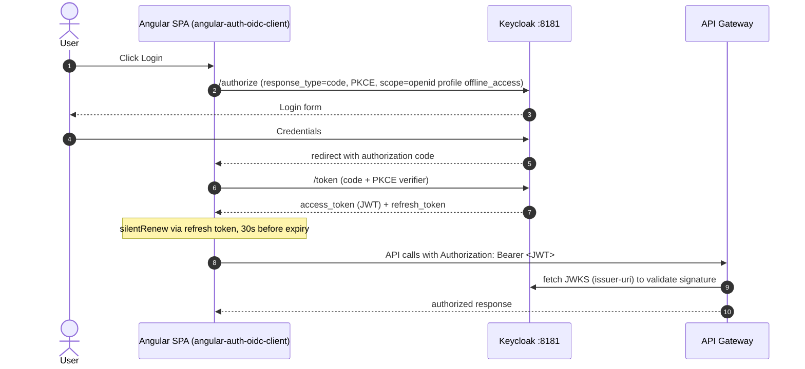

---

## 8. UML — Activity Diagram (Place Order)

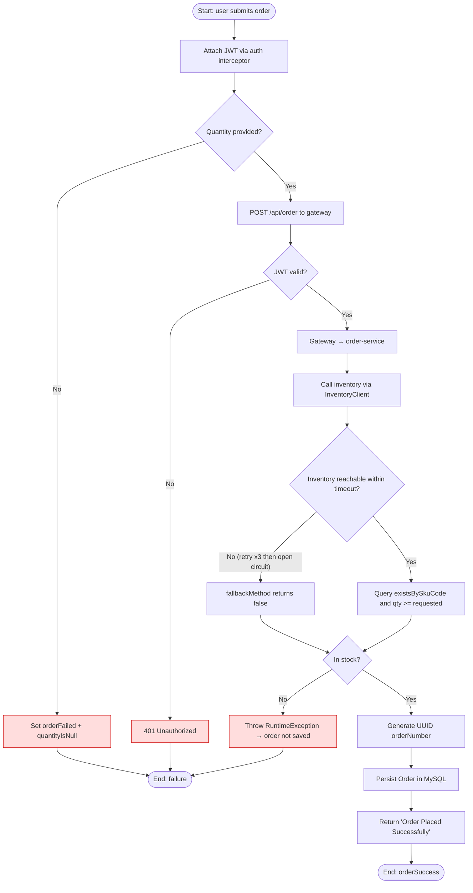

---

## 9. Resilience Design (Resilience4j)

The `order-service → inventory-service` call and every gateway route are wrapped in a circuit breaker. Order-service also adds **retry** and **time limiter**.

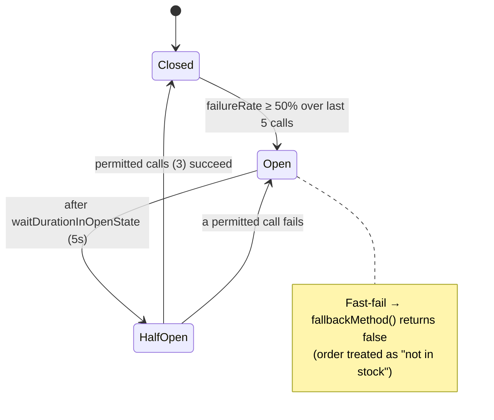

**order-service `inventory` instance:** sliding window = 5 (COUNT_BASED), failure threshold = 50%, wait in open = 5s, half-open permitted = 3, min calls = 5; **retry** max 3 attempts / 2s wait; **time limiter** 3s. Gateway uses the equivalent `default` config per route, forwarding to `/fallbackRoute` (HTTP 503) when open.

---

## 10. Cross-Cutting Concerns

| Concern | Implementation |
|---|---|
| **AuthN/AuthZ** | Keycloak realm `spring-microservices-security-realm`; gateway as OAuth2 Resource Server validating JWT via `issuer-uri`; SPA uses client `angular-client`. All API routes authenticated; Swagger paths public. |
| **CORS** | Configured at gateway (`GET, POST, PUT, DELETE, OPTIONS, HEAD`, default permit values). |
| **API docs** | springdoc per service, aggregated at gateway Swagger UI (`/swagger-ui.html`) via `/aggregate/*` routes. |
| **Health/metrics** | Spring Boot Actuator (`/actuator/*`), circuit-breaker health indicators enabled on gateway & order-service. |
| **DB migration** | Flyway on the JDBC-backed services (order, inventory); `ddl-auto=none` so schema is migration-managed (not auto-generated). |
| **Config** | Per-service `application.properties`; service URLs & DB credentials hardcoded to localhost (dev profile). |

---

## 11. Observations & Architectural Recommendations

**Strengths**
- Clean separation of concerns, database-per-service, and a single secured entry point.
- Modern stack (Java 21, Spring Boot 3.5, Angular 18 standalone, declarative HTTP interface client).
- Resilience is applied at two layers with a sensible fallback.

**Gaps / risks found during analysis**
1. **`userDetails` is dropped.** The frontend `Order` sends `email/firstName/lastName`, but `order-service`'s `OrderRequest`/`Order` have no such fields — customer identity is **not persisted**. This is the hook for the planned Kafka → notification-service (see commit "All the functionality before Kafka").
2. **No event/notification layer yet.** Order placement is fire-and-forget synchronous; no order-confirmation email/event. Kafka is the stated next step.
3. **No stock decrement.** `placeOrder` only *reads* inventory; it never decrements quantity, so stock never depletes and overselling is possible (no reservation/transaction).
4. **Hardcoded hosts.** Service URLs and DB credentials are baked into properties (`localhost`, plaintext passwords). Needs externalized config / secrets and (for scaling) service discovery instead of fixed `http://localhost:PORT`.
5. **No distributed tracing / centralized logging** (e.g., Micrometer Tracing + Zipkin/Tempo, ELK/Loki).
6. **Generic error handling.** "Not in stock" surfaces as a 500 `RuntimeException`; a domain-specific 4xx and `@ControllerAdvice` would be clearer.
7. **No containerization of the apps themselves.** Compose files cover only infra (DBs, Keycloak); the services/frontend run locally. A full compose/Helm for the apps + orchestration would complete the deployment story.

**Suggested roadmap**
- **Phase 1 (in progress):** Introduce Kafka; publish `OrderPlacedEvent` (incl. `userDetails`) from order-service → `notification-service` for email confirmation.
- **Phase 2:** Add inventory reservation/decrement with transactional guarantees (or Saga for cross-service consistency).
- **Phase 3:** Externalize config (Spring Cloud Config / env), add service discovery or K8s DNS, secrets management.
- **Phase 4:** Observability — Micrometer Tracing, Prometheus/Grafana, centralized logs.
- **Phase 5:** Containerize all apps; CI/CD; Kubernetes/Helm deployment.

---

## 12. Repository Layout

```
ms_sap_project/
├── api-gateway/        # Spring Cloud Gateway MVC, Security (OAuth2), Keycloak compose
├── product-service/    # MongoDB catalog service (:8080)
├── order-service/      # MySQL order service (:8081), InventoryClient, Resilience4j
├── inventory-service/  # MySQL stock service (:8082)
└── frontend/           # Angular 18 SPA (OIDC, product list, order, add-product)
```
