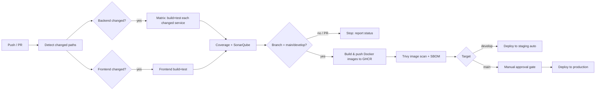

# CI/CD Pipeline — GitHub Actions (Detailed Plan)

> Companion to [ARCHITECTURE.md](ARCHITECTURE.md). A precise, implementation-ready plan to build, test, containerize, scan, and deploy this microservices monorepo (4 Spring Boot services + Angular frontend) with **GitHub Actions**.
> **Date:** 2026‑11‑08 • **Status:** Plan / proposal — no workflows exist yet (`.github/` is absent).

---

## 1. Goals

| Goal | How |
|---|---|
| Fast feedback on PRs | Build + test **only changed** modules (path filters + matrix) |
| Reproducible builds | Pinned JDK 21 / Node 20, dependency caching |
| Quality gates | Compile, unit + integration (Testcontainers) tests, coverage, lint, security scan |
| Immutable artifacts | Build OCI images, push to **GHCR** tagged by commit SHA |
| Safe delivery | Auto-deploy `develop` → staging; **manual approval** for `main` → production |
| Supply-chain safety | SBOM + image/dependency scanning, least-privilege `GITHUB_TOKEN` |

---

## 2. Repository facts the pipeline must respect

| Fact | Impact on pipeline |
|---|---|
| **4 independent Maven modules** (`api-gateway`, `order-service`, `inventory-service`, `product-service`) with **no parent/aggregator POM** | Each module builds independently → use a **matrix** per service, not one root `mvn` build |
| **Java 21**, Spring Boot 3.5.3 | `actions/setup-java` with Temurin 21 |
| **Testcontainers + WireMock + REST Assured** in tests | CI runner **must have Docker** (GitHub-hosted `ubuntu-latest` does) |
| **`mvnw` present only in `api-gateway` and `product-service`** | ⚠️ Add Maven Wrapper to `order-service` and `inventory-service`, **or** use a system Maven in CI. Plan standardizes on the wrapper. |
| **No Dockerfiles anywhere** | ⚠️ Must add a Dockerfile per service (or use **Jib**/Spring Boot buildpacks — see §7) |
| **Angular 18 frontend**, `npm`, `ng build`, `ng test` (Karma) | Separate Node job; run headless Chrome for tests |
| **Monorepo** | Path filters so a frontend change doesn't rebuild all backends |

> The three ⚠️ items are **prerequisites** (§7) that must land before the deploy stages are functional. The CI (build/test) stages work today.

---

## 3. Pipeline topology



### Stage breakdown
1. **Detect** — `dorny/paths-filter` outputs which services/frontend changed.
2. **Build & Test (CI)** — matrix per changed service: `mvn verify` (compile + unit + Testcontainers integration tests). Frontend: `npm ci && ng build && ng test`.
3. **Analyze** — aggregate JaCoCo coverage; optional SonarQube/SonarCloud quality gate.
4. **Package (CD)** — only on `main`/`develop`: build OCI image per service + frontend, tag `:<git-sha>` and `:latest`/`:<env>`, push to **GitHub Container Registry (ghcr.io)**.
5. **Scan** — Trivy scans images; generate CycloneDX SBOM; fail on CRITICAL/HIGH.
6. **Deploy** — `develop` → staging automatically; `main` → production behind a **GitHub Environment** protection rule (required reviewers).

---

## 4. Branch, environment & versioning strategy

| Item | Choice |
|---|---|
| Branching | Trunk-ish: `main` (prod), `develop` (staging), `feature/*` → PR into `develop` |
| Triggers | PR → CI only; push to `develop` → CI + deploy staging; push to `main` (or tag `v*`) → CI + deploy prod (approval) |
| Image tags | `ghcr.io/<owner>/<service>:<short-sha>` (immutable) + moving `:develop` / `:latest` |
| Environments | GitHub Environments `staging` and `production`; `production` requires reviewers + optional wait timer |
| Secrets | `GITHUB_TOKEN` (GHCR push), `KUBE_CONFIG_STAGING`, `KUBE_CONFIG_PROD` (or cloud OIDC), `SONAR_TOKEN` |

---

## 5. Workflow files

Place these under `.github/workflows/`.

### 5.1 `ci.yml` — build & test on every PR and push

```yaml
name: CI

on:
  pull_request:
    branches: [main, develop]
  push:
    branches: [main, develop]

permissions:
  contents: read

concurrency:
  group: ci-${{ github.ref }}
  cancel-in-progress: true

jobs:
  changes:
    runs-on: ubuntu-latest
    outputs:
      api-gateway: ${{ steps.filter.outputs.api-gateway }}
      order-service: ${{ steps.filter.outputs.order-service }}
      inventory-service: ${{ steps.filter.outputs.inventory-service }}
      product-service: ${{ steps.filter.outputs.product-service }}
      frontend: ${{ steps.filter.outputs.frontend }}
    steps:
      - uses: actions/checkout@v4
      - uses: dorny/paths-filter@v3
        id: filter
        with:
          filters: |
            api-gateway: ['api-gateway/**']
            order-service: ['order-service/**']
            inventory-service: ['inventory-service/**']
            product-service: ['product-service/**']
            frontend: ['frontend/**']

  backend:
    needs: changes
    runs-on: ubuntu-latest   # has Docker for Testcontainers
    strategy:
      fail-fast: false
      matrix:
        service: [api-gateway, order-service, inventory-service, product-service]
    steps:
      - uses: actions/checkout@v4

      - name: Skip unchanged service
        id: guard
        run: |
          changed='${{ needs.changes.outputs[matrix.service] }}'
          echo "changed=$changed" >> "$GITHUB_OUTPUT"

      - uses: actions/setup-java@v4
        if: steps.guard.outputs.changed == 'true'
        with:
          distribution: temurin
          java-version: '21'
          cache: maven

      - name: Build & test (mvnw)
        if: steps.guard.outputs.changed == 'true'
        working-directory: ${{ matrix.service }}
        run: ./mvnw -B -ntp verify

      - name: Upload test reports
        if: steps.guard.outputs.changed == 'true' && always()
        uses: actions/upload-artifact@v4
        with:
          name: surefire-${{ matrix.service }}
          path: ${{ matrix.service }}/target/*-reports/

  frontend:
    needs: changes
    if: needs.changes.outputs.frontend == 'true'
    runs-on: ubuntu-latest
    defaults:
      run:
        working-directory: frontend
    steps:
      - uses: actions/checkout@v4
      - uses: actions/setup-node@v4
        with:
          node-version: '20'
          cache: npm
          cache-dependency-path: frontend/package-lock.json
      - run: npm ci
      - run: npm run build -- --configuration production
      - run: npm test -- --watch=false --browsers=ChromeHeadless
```

> **Note:** the matrix uses `./mvnw`, so `order-service` and `inventory-service` need the wrapper added (§7.1). Until then, swap `./mvnw` for `mvn` and add `maven` to the toolchain, or add the wrapper (recommended).

### 5.2 `cd.yml` — build, scan & push images, then deploy

```yaml
name: CD

on:
  push:
    branches: [main, develop]
  workflow_dispatch:

permissions:
  contents: read
  packages: write        # push to GHCR
  id-token: write        # cloud OIDC (optional)

env:
  REGISTRY: ghcr.io

jobs:
  build-push:
    runs-on: ubuntu-latest
    strategy:
      matrix:
        service: [api-gateway, order-service, inventory-service, product-service, frontend]
    steps:
      - uses: actions/checkout@v4

      - uses: actions/setup-java@v4
        if: matrix.service != 'frontend'
        with: { distribution: temurin, java-version: '21', cache: maven }

      - name: Build Spring Boot jar
        if: matrix.service != 'frontend'
        working-directory: ${{ matrix.service }}
        run: ./mvnw -B -ntp clean package -DskipTests   # tests already ran in CI

      - uses: docker/setup-buildx-action@v3

      - name: Log in to GHCR
        uses: docker/login-action@v3
        with:
          registry: ${{ env.REGISTRY }}
          username: ${{ github.actor }}
          password: ${{ secrets.GITHUB_TOKEN }}

      - name: Metadata (tags)
        id: meta
        uses: docker/metadata-action@v5
        with:
          images: ${{ env.REGISTRY }}/${{ github.repository_owner }}/${{ matrix.service }}
          tags: |
            type=sha,format=short
            type=ref,event=branch

      - name: Build & push image
        uses: docker/build-push-action@v6
        with:
          context: ./${{ matrix.service }}
          push: true
          tags: ${{ steps.meta.outputs.tags }}
          labels: ${{ steps.meta.outputs.labels }}
          cache-from: type=gha
          cache-to: type=gha,mode=max

      - name: Trivy image scan
        uses: aquasecurity/trivy-action@0.28.0
        with:
          image-ref: ${{ env.REGISTRY }}/${{ github.repository_owner }}/${{ matrix.service }}:sha-${{ github.sha }}
          format: sarif
          output: trivy-${{ matrix.service }}.sarif
          severity: CRITICAL,HIGH
          exit-code: '1'
          ignore-unfixed: true

      - name: Upload SARIF
        if: always()
        uses: github/codeql-action/upload-sarif@v3
        with:
          sarif_file: trivy-${{ matrix.service }}.sarif

  deploy-staging:
    needs: build-push
    if: github.ref == 'refs/heads/develop'
    runs-on: ubuntu-latest
    environment: staging
    steps:
      - uses: actions/checkout@v4
      - name: Deploy to staging (kubectl / helm)
        run: echo "helm upgrade --install ... --set image.tag=sha-${{ github.sha }}"
        # Example:
        # - uses: azure/setup-kubectl@v4
        # - run: kubectl apply -k k8s/overlays/staging

  deploy-production:
    needs: build-push
    if: github.ref == 'refs/heads/main'
    runs-on: ubuntu-latest
    environment: production     # protection rule: required reviewers
    steps:
      - uses: actions/checkout@v4
      - name: Deploy to production
        run: echo "helm upgrade --install ... --set image.tag=sha-${{ github.sha }}"
```

### 5.3 `codeql.yml` (optional, recommended) — static security analysis

```yaml
name: CodeQL
on:
  push: { branches: [main, develop] }
  pull_request: { branches: [main] }
  schedule: [{ cron: '0 3 * * 1' }]
permissions: { security-events: write, contents: read }
jobs:
  analyze:
    runs-on: ubuntu-latest
    strategy:
      matrix:
        language: [java-kotlin, javascript-typescript]
    steps:
      - uses: actions/checkout@v4
      - uses: github/codeql-action/init@v3
        with: { language: ${{ matrix.language }} }
      - uses: github/codeql-action/autobuild@v3
      - uses: github/codeql-action/analyze@v3
```

---

## 6. Caching, performance & reliability

| Concern | Approach |
|---|---|
| Maven deps | `setup-java` `cache: maven` (keyed on `pom.xml`) |
| npm deps | `setup-node` `cache: npm` keyed on `package-lock.json` |
| Docker layers | `cache-from/to: type=gha` in buildx |
| Don't rebuild everything | `dorny/paths-filter` + per-service matrix guard |
| Testcontainers | Works on `ubuntu-latest` (Docker preinstalled); pull images are cached per run |
| Avoid duplicate runs | `concurrency` with `cancel-in-progress` |
| Flaky tests | `fail-fast: false` so one service's failure doesn't mask others |

---

## 7. Prerequisites to implement before CD works

### 7.1 Add Maven Wrapper to the two missing services
```bash
cd order-service     && mvn -N wrapper:wrapper -Dmaven=3.9.9
cd ../inventory-service && mvn -N wrapper:wrapper -Dmaven=3.9.9
```
Commit `mvnw`, `mvnw.cmd`, `.mvn/wrapper/` so CI uses a pinned Maven for all four services.

### 7.2 Add a Dockerfile per Spring Boot service
Two options:

**Option A — hand-written multi-stage Dockerfile** (one per `*/`):
```dockerfile
# --- build stage ---
FROM eclipse-temurin:21-jdk AS build
WORKDIR /app
COPY .mvn/ .mvn/
COPY mvnw pom.xml ./
RUN ./mvnw -B -ntp dependency:go-offline
COPY src ./src
RUN ./mvnw -B -ntp clean package -DskipTests

# --- runtime stage ---
FROM eclipse-temurin:21-jre
WORKDIR /app
COPY --from=build /app/target/*.jar app.jar
EXPOSE 8080
ENTRYPOINT ["java","-jar","/app/app.jar"]
```

**Option B — no Dockerfile at all (recommended for Spring Boot):** use **buildpacks** or **Jib** and skip `docker/build-push-action`:
```bash
# Spring Boot buildpacks (produces an optimized OCI image, no Dockerfile)
./mvnw spring-boot:build-image \
  -Dspring-boot.build-image.imageName=ghcr.io/<owner>/<service>:sha-<sha>
```
Jib alternative avoids needing a Docker daemon entirely in CI.

### 7.3 Frontend Dockerfile (Nginx static serve)

```dockerfile
FROM node:20 AS build
WORKDIR /app
COPY package*.json ./
RUN npm ci
COPY . .
RUN npm run build -- --configuration production
FROM nginx:1.27-alpine
COPY --from=build /app/dist/*/browser /usr/share/nginx/html
```

### 7.4 Externalize config for environments
Replace hardcoded `localhost` service URLs / DB credentials (see ARCHITECTURE.md §11) with env vars / Spring profiles so the same image runs in staging and prod. Provide DB hosts, `issuer-uri`, and `inventory.url` via Kubernetes `ConfigMap`/`Secret`.

---

## 8. Secrets & permissions checklist

| Secret / setting | Used by |
|---|---|
| `GITHUB_TOKEN` (built-in, `packages: write`) | Push images to GHCR |
| `SONAR_TOKEN` | SonarCloud quality gate (optional) |
| `KUBE_CONFIG_STAGING` / `KUBE_CONFIG_PROD` **or** cloud OIDC role | Deploy jobs |
| GitHub **Environments** `staging`, `production` | Approvals, env-scoped secrets |
| Least privilege | Default `permissions: contents: read`; elevate per-job only |

---

## 9. Roadmap to adopt

1. **Phase 1 — CI:** add `mvnw` to the two services, land `ci.yml` (build + test + path filters). Green PRs.
2. **Phase 2 — Images:** add Dockerfiles/Jib + `cd.yml` build-push to GHCR with SHA tags + Trivy scan.
3. **Phase 3 — Deploy staging:** externalize config; add K8s/Helm manifests; auto-deploy `develop` → staging.
4. **Phase 4 — Deploy prod:** `production` environment with required reviewers; promote by image SHA.
5. **Phase 5 — Hardening:** CodeQL, SBOM, Dependabot, coverage gate, smoke/health checks post-deploy, rollback strategy.

---

## 10. Summary

| | |
|---|---|
| **CI** | `ci.yml` — path-filtered, per-service matrix `mvnw verify` (Testcontainers) + Angular build/test |
| **CD** | `cd.yml` — matrix image build → GHCR (`:sha`) → Trivy scan → staging (auto) / prod (approval) |
| **Security** | Trivy, CodeQL, SBOM, least-privilege tokens, env protection rules |
| **Blockers to clear first** | add `mvnw` ×2, add Dockerfiles (or Jib/buildpacks), externalize config |
