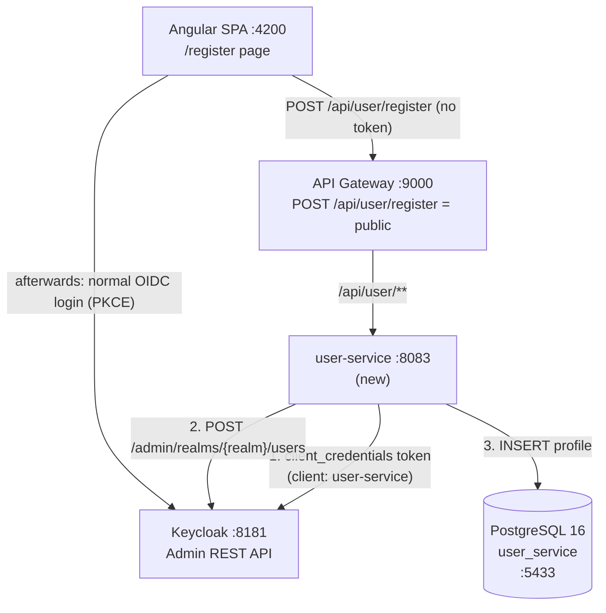
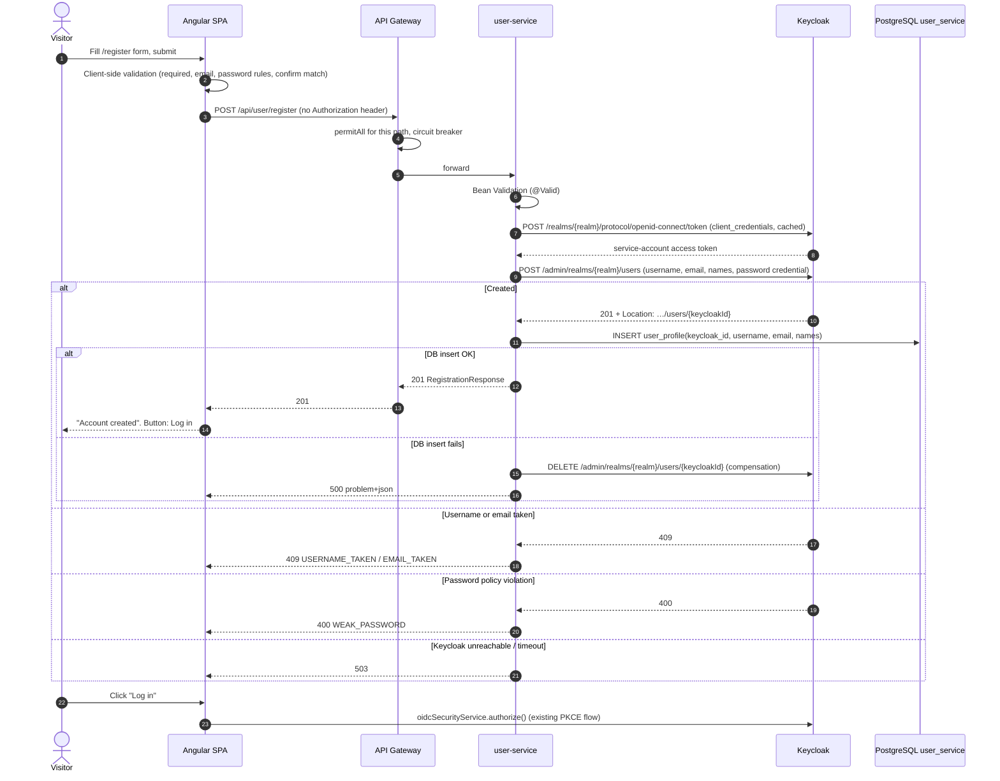
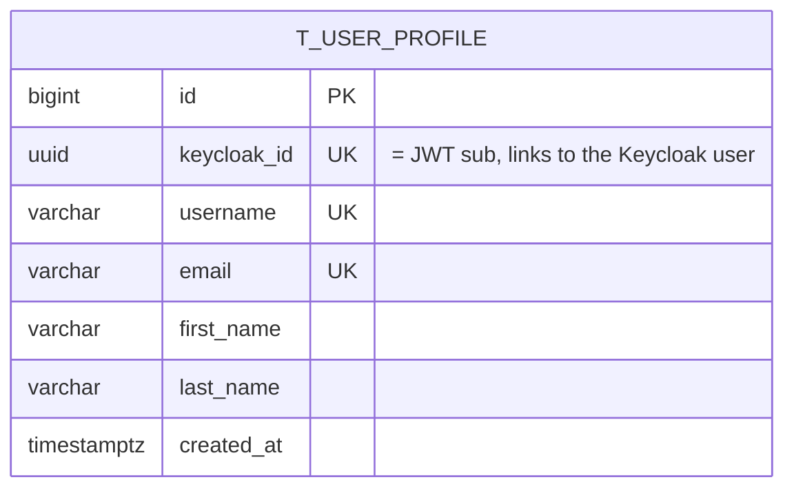

# Registration Function — Implementation Plan

> **Trello card:** [Registration function](https://trello.com/c/CQHr7eED/2-registration-function) (SAP_MS board, *In progress*)
> **Card text:** "Registration function add as different microservice, implementing the front-end functions too."
> **Date:** 2026‑11‑08 • **Branch base:** `development`
> **Related docs:** [ARCHITECTURE.md](ARCHITECTURE.md), [RUNNING.md](RUNNING.md), [TEST_PLAN.md](TEST_PLAN.md), [DATABASE_CLOUD_STRATEGY.md](DATABASE_CLOUD_STRATEGY.md), [CICD_PIPELINE.md](CICD_PIPELINE.md)

---

## 1. Goal

Let a new customer create an account from the Angular app and then log in with it. The work has two parts:

1. A new **`user-service`** microservice that owns registration and the customer profile.
2. A **Register page** in the Angular app, linked from the header.

### Where we start

| Area | Current state | Consequence |
|---|---|---|
| Keycloak realm `spring-microservices-security-realm` | `registrationAllowed = false`, one seeded user (`testuser`), no password policy, no SMTP | Nobody can sign up today. Keycloak is the only user store. |
| Keycloak clients | Only `angular-client` (public, PKCE) | Nothing can call the Keycloak Admin API yet. |
| API gateway `SecurityConfig` | `anyRequest().authenticated()`; only Swagger paths are public | A sign-up call (made before the user has a token) would get **401**. |
| Gateway `fallbackRoute` | Registered with `.GET(...)` only | A `POST` forwarded to the fallback when a circuit is open won't match it (expect 404/405, not 503). |
| Frontend | Routes `''` and `add-product`; header shows only Login/Logout | No registration UI, no user service. |
| `home-page.component.ts` `orderProduct()` | Reads `userData.firstName` / `userData.lastName` | Keycloak's claims are `given_name` / `family_name`, so these are always `undefined`. Registered names would never reach orders. |

---

## 2. Key design decision: who owns users?

Keycloak already stores identities and credentials, and the gateway trusts only Keycloak-issued JWTs. So **the user-service must create the user *in Keycloak***. It must not keep its own password store.

| Option | How it works | Verdict |
|---|---|---|
| **A. Keycloak self-registration only** | Set `registrationAllowed: true`; the SPA links to Keycloak's built-in register page | Simplest, but there's **no microservice** and no profile data of our own. Doesn't meet the card. |
| **B. user-service with its own password table** | Hash passwords in our DB, issue our own tokens | ❌ Creates a second identity provider next to Keycloak. Tokens wouldn't be trusted by the gateway. |
| **C. user-service → Keycloak Admin API (chosen)** | Angular form → gateway → user-service. The service validates the input, creates the user in Keycloak through the Admin REST API (service-account client), then saves a **profile** row (no password) in its own DB | ✅ Meets the card. Keeps Keycloak as the single source of credentials, follows database-per-service, and gives us a place for customer data later (addresses, Kafka notifications). |

**Rule:** the password goes straight through user-service to Keycloak. It is **never stored, logged, or returned**.

---

## 3. Target architecture



### 3.1 Port & component map (additions)

| Component | Port | Notes |
|---|---|---|
| `user-service` | **8083** | Next free port after inventory-service (8082) |
| PostgreSQL for user-service | **5433** on the host (5432 in the container) | Host port 5433 avoids clashing with a local Postgres. PostgreSQL 16 follows the decision record in DATABASE_CLOUD_STRATEGY.md §8, and a new service has no migration cost. |

### 3.2 Registration sequence



---

## 4. API contract (user-service)

All paths are reached through the gateway at `http://localhost:9000`.

### 4.1 `POST /api/user/register` (public)

Request:

```json
{
  "username": "jdoe",
  "email": "jdoe@example.com",
  "firstName": "John",
  "lastName": "Doe",
  "password": "Str0ngPassw0rd"
}
```

| Field | Rules (backend `@Valid` + same rules in the Angular form) |
|---|---|
| `username` | required, 3–50 chars, `^[a-zA-Z0-9._-]+$`. Keycloak stores it lower-case, so normalize to lower-case. |
| `email` | required, `@Email`, max 254 |
| `firstName`, `lastName` | required, 1–100 chars |
| `password` | required, 8–128 chars, at least 1 digit, 1 upper-case, 1 lower-case. Must not equal the username. Mirrors the Keycloak password policy (§6). |

`confirmPassword` is checked **only in the frontend** and is not sent.

Responses:

| Status | When | Body |
|---|---|---|
| **201 Created** | Account created | `{ "id": "<keycloakId>", "username", "email", "firstName", "lastName", "createdAt" }` |
| **400 Bad Request** | Bean Validation fails, or Keycloak rejects the password (policy) | RFC 7807 `ProblemDetail`: `code` = `VALIDATION_FAILED` or `WEAK_PASSWORD`, plus `errors: { field: message }` |
| **409 Conflict** | Username or email already exists | `ProblemDetail`, `code` = `USERNAME_TAKEN` or `EMAIL_TAKEN` |
| **503 Service Unavailable** | Keycloak down or timed out | `ProblemDetail`, `code` = `IDENTITY_PROVIDER_UNAVAILABLE` |
| **500** | Unexpected error (after compensation) | `ProblemDetail`, no internals |

> Use Spring's built-in `ProblemDetail` with a `@RestControllerAdvice`. This also starts on the "generic 500" finding from ARCHITECTURE.md §11 (item 6), for the new service at least.

### 4.2 `GET /api/user/me` (authenticated, stretch goal)

Returns the caller's profile, looked up by the JWT `sub` (= Keycloak user id). Lets us verify end to end that the profile was saved, and gives the frontend a profile source later. **404** if no profile exists, e.g. for the seeded `testuser`, who was created by the realm import.

---

## 5. user-service — backend design

Copy the structure and conventions of `order-service` (Spring Boot 3.5.3, Java 21, Lombok, springdoc 2.8.9, Flyway, Testcontainers, REST Assured).

### 5.1 Module layout

```
user-service/
├── docker-compose.yml                    # postgres:16, container user-service-postgres, 5433:5432
├── pom.xml
├── mvnw, mvnw.cmd, .mvn/wrapper/         # include the wrapper from day one (CICD_PIPELINE.md §2)
└── src/
    ├── main/java/com/techie/microservices/user/
    │   ├── UserServiceApplication.java
    │   ├── config/
    │   │   ├── OpenAPIConfig.java
    │   │   ├── SecurityConfig.java        # resource server; permitAll POST /api/user/register + api-docs
    │   │   └── KeycloakClientConfig.java  # RestClient + OAuth2 client_credentials interceptor + HttpServiceProxyFactory
    │   ├── client/
    │   │   └── KeycloakAdminClient.java   # @HttpExchange interface (same style as InventoryClient)
    │   ├── controller/
    │   │   └── UserController.java        # POST /api/user/register, GET /api/user/me
    │   ├── dto/
    │   │   ├── RegistrationRequest.java   # record + jakarta.validation annotations; toString() masks password
    │   │   ├── RegistrationResponse.java
    │   │   └── keycloak/                  # UserRepresentation, CredentialRepresentation (only the fields we send)
    │   ├── exception/
    │   │   ├── UserAlreadyExistsException.java
    │   │   ├── WeakPasswordException.java
    │   │   ├── IdentityProviderUnavailableException.java
    │   │   └── GlobalExceptionHandler.java  # @RestControllerAdvice → ProblemDetail
    │   ├── model/
    │   │   └── UserProfile.java           # @Entity t_user_profile
    │   ├── repository/
    │   │   └── UserProfileRepository.java
    │   └── service/
    │       └── RegistrationService.java   # orchestration + compensation
    ├── main/resources/
    │   ├── application.properties
    │   └── db/migration/V1__init.sql
    └── test/java/...                      # see §9
```

### 5.2 Dependencies (`pom.xml`)

- `spring-boot-starter-web`, `spring-boot-starter-validation`, `spring-boot-starter-data-jpa`, `spring-boot-starter-actuator`
- `spring-boot-starter-oauth2-client`: supplies `OAuth2ClientHttpRequestInterceptor` (Spring Security 6.4+, part of Boot 3.5), which gets and caches the client_credentials token for `RestClient`
- `spring-boot-starter-oauth2-resource-server`: for `GET /api/user/me`, and so the service doesn't trust unauthenticated callers on its own port (TEST_PLAN.md §7 finding)
- `org.postgresql:postgresql` (runtime), `org.flywaydb:flyway-core`, `org.flywaydb:flyway-database-postgresql`
- `springdoc-openapi-starter-webmvc-ui` 2.8.9, Lombok
- Resilience4j circuit breaker + time limiter on the Keycloak calls (same starter as order-service)
- Test: `spring-boot-starter-test`, `spring-boot-testcontainers`, `org.testcontainers:postgresql`, `org.testcontainers:junit-jupiter`, `rest-assured`, and `com.github.dasniko:testcontainers-keycloak` (3.3.x line, for Keycloak 24)

> **Why not `keycloak-admin-client`?** It pulls in RESTEasy/JAX-RS next to Spring MVC, and its version has to track the server. The service needs three endpoints (token, create user, delete user). A small `@HttpExchange` interface matches how order-service already calls inventory-service, and adds no new HTTP stack.

### 5.3 `KeycloakAdminClient`

```java
@HttpExchange("/admin/realms/{realm}/users")
public interface KeycloakAdminClient {
    @PostExchange
    ResponseEntity<Void> createUser(@PathVariable String realm, @RequestBody UserRepresentation user); // 201 + Location

    @DeleteExchange("/{id}")
    void deleteUser(@PathVariable String realm, @PathVariable String id);
}
```

- The Keycloak user id is the last path segment of the `Location` header.
- Keycloak answers **409** with `errorMessage` "User exists with same username" or "...same email". Map it to `USERNAME_TAKEN` / `EMAIL_TAKEN`.
- Keycloak answers **400** for a password-policy failure (`error` like `invalidPasswordMinLengthMessage`). Map it to `WEAK_PASSWORD`.
- Wrap the call in a circuit breaker + 3 s time limiter (instance `keycloak`, same settings as `inventory` in order-service). The fallback throws `IdentityProviderUnavailableException` → **503**. **No retry on `createUser`**: it isn't idempotent, and a retry after a timeout could produce a misleading 409.

### 5.4 `RegistrationService.register(request)`

1. Normalize: trim fields; lower-case `username` and `email`.
2. Optional fast pre-check: `existsByUsernameOrEmail` on the local table. This gives a quick 409 without calling Keycloak, but Keycloak and the DB unique constraints are the real guards.
3. Build a `UserRepresentation`: `enabled=true`, `emailVerified=false`, `credentials=[{type:"password", value, temporary:false}]`.
4. `createUser` → extract `keycloakId`.
5. Save a `UserProfile` (in a `@Transactional` method separate from the remote call).
6. If step 5 throws: call `deleteUser(keycloakId)` (compensation), then rethrow. If the compensation also fails, log at ERROR with the `keycloakId` (never the password) so the orphan can be cleaned up by hand.
7. Return `RegistrationResponse`.

### 5.5 Data model — `V1__init.sql`

```sql
CREATE TABLE t_user_profile
(
    id          BIGSERIAL PRIMARY KEY,
    keycloak_id UUID         NOT NULL UNIQUE,
    username    VARCHAR(50)  NOT NULL UNIQUE,
    email       VARCHAR(254) NOT NULL UNIQUE,
    first_name  VARCHAR(100) NOT NULL,
    last_name   VARCHAR(100) NOT NULL,
    created_at  TIMESTAMPTZ  NOT NULL DEFAULT now()
);
```



There is no password column. `keycloak_id` is the cross-system key, the same "logical link" pattern that `skuCode` uses between the other services.

### 5.6 `application.properties`

```properties
spring.application.name=user-service
server.port=8083
spring.datasource.url=jdbc:postgresql://localhost:5433/user_service
spring.datasource.username=${USER_DB_USERNAME:postgres}
spring.datasource.password=${USER_DB_PASSWORD:postgres}
spring.jpa.hibernate.ddl-auto=none
springdoc.swagger-ui.path=/swagger-ui.html
springdoc.api-docs.path=/api-docs

keycloak.base-url=http://localhost:8181
keycloak.realm=spring-microservices-security-realm

# client_credentials for the Admin API
spring.security.oauth2.client.registration.keycloak-admin.provider=keycloak
spring.security.oauth2.client.registration.keycloak-admin.client-id=user-service
spring.security.oauth2.client.registration.keycloak-admin.client-secret=${KEYCLOAK_USER_SERVICE_SECRET:change-me-dev-secret}
spring.security.oauth2.client.registration.keycloak-admin.authorization-grant-type=client_credentials
spring.security.oauth2.client.provider.keycloak.token-uri=${keycloak.base-url}/realms/${keycloak.realm}/protocol/openid-connect/token

# resource server (GET /api/user/me)
spring.security.oauth2.resourceserver.jwt.issuer-uri=${keycloak.base-url}/realms/${keycloak.realm}

management.endpoints.web.exposure.include=health,info,circuitbreakers
management.health.circuitbreakers.enabled=true
```

Secrets come from env vars with dev defaults. That's a small step toward ARCHITECTURE.md §11 item 4 without changing the other services.

### 5.7 Security notes

- `RegistrationRequest` is a record, and a record's generated `toString()` **includes the password**. Override `toString()` to mask it, and don't log request bodies.
- Return 409 for duplicates. This reveals that an account exists, which is normal for a shop sign-up, but write it down as an accepted risk.
- The public endpoint can be abused (account spam). In this scope: rely on Keycloak's brute-force protection for logins (already on). Follow-up: a gateway rate limit (e.g. Bucket4j per IP) on `POST /api/user/register`.
- The `user-service` Keycloak client gets **only** `manage-users`, `view-users` and `query-users` from `realm-management`. Never `realm-admin`.

---

## 6. Keycloak changes (`api-gateway/docker/keycloak/realms/realm-export.json`)

1. **New confidential client `user-service`:** `publicClient: false`, `serviceAccountsEnabled: true`, `standardFlowEnabled: false`, `directAccessGrantsEnabled: false`, `secret: "change-me-dev-secret"` (dev only, overridden by env var).
2. **Service-account user** `service-account-user-service` with `serviceAccountClientId: "user-service"` and `clientRoles: { "realm-management": ["manage-users", "view-users", "query-users"] }`.
3. **Password policy** on the realm: `"passwordPolicy": "length(8) and digits(1) and upperCase(1) and lowerCase(1) and notUsername(undefined)"`, matching §4.1.
4. Keep `registrationAllowed: false`, so user-service is the **only** sign-up path.
5. Optional: `"registrationEmailAsUsername": false` stays as it is. We collect an explicit username because the header shows `preferred_username`.

> ⚠️ **Re-import gotcha:** `start-dev --import-realm` skips a realm that already exists. Also, the compose file sets the legacy `DB_*` variables, not `KC_DB*`, so Keycloak 24 seems to be using its built-in dev database inside the container, not `keycloak-mysql`. Verify this. To pick up the new client, recreate the container: `cd api-gateway && docker compose up -d --force-recreate keycloak`. Otherwise add the client in the admin console by hand. Document both ways in RUNNING.md §4.

---

## 7. API gateway changes

**`Routes.java`:**

```java
@Bean
public RouterFunction<ServerResponse> userServiceRoute() {
    return route("user_service")
            .route(RequestPredicates.path("/api/user/**"), HandlerFunctions.http("http://localhost:8083"))
            .filter(CircuitBreakerFilterFunctions.circuitBreaker("userServiceCircuitBreaker",
                    URI.create("forward:/fallbackRoute")))
            .build();
}

@Bean
public RouterFunction<ServerResponse> userServiceSwaggerRoute() { /* same pattern as the others → /aggregate/user-service/v3/api-docs */ }
```

Also change `fallbackRoute` from `.GET("/fallbackRoute", …)` to match **any method** (`.route(RequestPredicates.path("/fallbackRoute"), …)`). Otherwise a `POST /api/user/register` with an open circuit won't get the 503.

**`SecurityConfig.java`:**

```java
.authorizeHttpRequests(authorize -> authorize
        .requestMatchers(freeResourceUrls).permitAll()
        .requestMatchers(HttpMethod.POST, "/api/user/register").permitAll()
        .requestMatchers("/fallbackRoute").permitAll()   // TEST_PLAN.md §7 finding
        .anyRequest().authenticated())
```

**`application.properties`:** add `springdoc.swagger-ui.urls[3].name=User Service` / `urls[3].url=/aggregate/user-service/v3/api-docs`.

---

## 8. Frontend changes (Angular 18, standalone)

| File | Change |
|---|---|
| `src/app/model/user-registration.ts` *(new)* | `UserRegistration` (request) and `RegisteredUser` (response) interfaces |
| `src/app/services/user/user.service.ts` *(new)* + spec | `register(req): Observable<RegisteredUser>` → `POST http://localhost:9000/api/user/register`. Same style as `ProductService`. |
| `src/app/pages/register/register.component.{ts,html,css,spec.ts}` *(new)* | Reactive form, see below |
| `src/app/validators/password-match.validator.ts` *(new)* | Group validator: `password === confirmPassword` |
| `src/app/app.routes.ts` | `{ path: 'register', component: RegisterComponent }` |
| `src/app/shared/header/header.component.{ts,html}` | When **not** authenticated, show a **Register** link (`routerLink="/register"`, add `RouterLink` to `imports`) next to **Login** |
| `src/app/pages/home-page/home-page.component.ts` | Fix `userDetails`: use `userData.given_name` / `userData.family_name` (and `take(1)`, UI‑4), so names entered at registration reach orders |

### 8.1 Register component behaviour

- **Fields:** username, email, first name, last name, password, confirm password. Tailwind styling matches `add-product`.
- **Validators** mirror §4.1: `required`, `minLength`/`maxLength`, `pattern` for username and password strength, `Validators.email`, plus the group password-match validator. Messages show when a field is `touched && invalid`. Avoid UI‑5 here: each message in the template must have a validator behind it.
- **Submit:** disabled while the form is invalid **or** a request is in flight (`isSubmitting`), so double-clicks can't create duplicates.
- **States:** clear `successMessage` / `errorMessage` at the start of every submit (avoids UI‑2).
  - `201` → show "Account created, you can now log in". Reset the form, show a **Log in** button that calls `oidcSecurityService.authorize()`.
  - `409` → put the error on the matching control (`username` or `email` → `{ taken: true }`).
  - `400` → map `errors{}` from the ProblemDetail onto the controls; show `WEAK_PASSWORD` under the password field.
  - `503` / network error → generic "Registration is temporarily unavailable, please try again later".
- **Logged-in users** who open `/register` see "You are already logged in" and no form. Use a guest-only check on `isAuthenticated$`, or a small `CanActivateFn` guest guard.
- The auth interceptor adds no `Authorization` header when there is no token, so the anonymous call goes through unchanged.

---

## 9. Testing

### 9.1 user-service

| Level | What | Tools |
|---|---|---|
| Unit | `RegistrationService`: happy path; 409 username/email mapping; 400 weak password; **compensation** (DB save throws → `deleteUser` called); compensation failure is logged | JUnit 5, Mockito |
| Unit | `RegistrationRequest` validation (each rule); `toString()` masks the password | Jakarta Validator |
| Web slice | `@WebMvcTest(UserController)`: status codes + ProblemDetail shape for each exception | MockMvc |
| Integration | `UserServiceApplicationTests`: real **PostgreSQL** + real **Keycloak** (testcontainers-keycloak importing a test realm with the `user-service` client). Register → 201 → user exists in Keycloak → row in DB → **password grant login works** with the new credentials. Duplicate → 409. | Testcontainers, REST Assured |
| Integration (fallback) | Keycloak stopped or stubbed slow → 503 within the time limit | WireMock (as in order-service) |

### 9.2 API tests (Bruno / Postman / Insomnia)

Add folder **`7. Registration (user-service, PostgreSQL, Keycloak)`** to `api-tests/bruno` and to the Postman collection:

1. Register new user (random suffix via a pre-request script) → 201
2. Register the same username → 409 `USERNAME_TAKEN`
3. Same email, different username → 409 `EMAIL_TAKEN`
4. Weak password → 400
5. Missing fields / bad email → 400 with field errors
6. Get a token for the new user (password grant) → 200; then `GET /api/product` → 200
7. `GET /api/user/me` with that token → 200 (stretch)
8. Folder 1 addition: `POST /api/user/register` **without a token is allowed** (not 401)

### 9.3 UI test cases (add to TEST_PLAN.md §6.3)

| # | Scenario | Expected |
|---|---|---|
| UI‑16 | Header logged out | **Register** link next to **Login** |
| UI‑17 | Empty / invalid form | Field messages; submit disabled |
| UI‑18 | Passwords don't match | "Passwords do not match"; submit disabled |
| UI‑19 | Successful registration | `POST :9000/api/user/register → 201`, success message, **Log in** → Keycloak → back as "Hi <username>" |
| UI‑20 | Duplicate username / email | Error under the matching field; form keeps its values (except the password fields) |
| UI‑21 | user-service stopped | "temporarily unavailable" message, **503** from the gateway (needs the fallback fix in §7) |
| UI‑22 | Open `/register` while logged in | "already logged in", no form |
| UI‑23 | Order after registering | Order succeeds; request body `userDetails` has first/last name (home-page fix) |

---

## 10. Tooling & docs

- **`launch.sh`:** add `user-service:8083` to `BACKEND_SERVICES` (before `api-gateway`) and `user-service` to `COMPOSE_DIRS`. Add a `user_db_ready()` check (`docker exec user-service-postgres pg_isready -U postgres`) and a wait step. Update the step numbers (6 → 7), the preflight ports message, and the `status` container filter.
- **`.gitignore`:** ignore `user-service/postgres-data/` (or whatever the compose volume path is).
- **ARCHITECTURE.md:** add user-service to the §1 table, the §3 diagram and port map, the §5 ER diagrams, the §6 class diagram, and a new §7.4 "Register user" sequence (copy §3.2 above). Update §12 layout.
- **RUNNING.md:** new service step, port map row, the Keycloak re-import note (§6 above), smoke-test curl for registration.
- **TEST_PLAN.md:** new API folder (§9.2) and UI cases (§9.3).
- **CICD_PIPELINE.md:** add `user-service` to the service matrix.

---

## 11. Task breakdown (Trello checklist)

Estimates assume one developer who knows the codebase. Each line can become a checklist item on the card.

| # | Task | Depends on | Est. |
|---|---|---|---|
| T1 | Keycloak: `user-service` client, service-account roles, password policy in `realm-export.json`; verify re-import | — | 0.5 d |
| T2 | Scaffold `user-service` (pom, wrapper, compose with Postgres, `application.properties`, Flyway V1, OpenAPI config) | — | 0.5 d |
| T3 | `KeycloakAdminClient` + client_credentials `RestClient` config + circuit breaker / time limiter | T1, T2 | 0.5 d |
| T4 | `RegistrationService` (normalize, create, persist, compensate) + entity/repository | T3 | 0.5 d |
| T5 | `UserController`, DTOs + validation, `GlobalExceptionHandler` (ProblemDetail), `SecurityConfig` (resource server) | T4 | 0.5 d |
| T6 | Backend tests: unit + web slice + Testcontainers (Postgres + Keycloak) | T5 | 1 d |
| T7 | Gateway: route + swagger route, public `POST /api/user/register`, any-method `/fallbackRoute`, swagger URL | T5 | 0.25 d |
| T8 | Frontend: model, `UserService`, password-match validator | — (contract in §4) | 0.25 d |
| T9 | Frontend: `RegisterComponent` (form, states, error mapping, guest check) + route + header link | T8 | 1 d |
| T10 | Frontend: fix `userDetails` claim names + `take(1)` in `home-page` | — | 0.1 d |
| T11 | Frontend unit tests (component + service specs) | T9 | 0.5 d |
| T12 | `launch.sh` + `.gitignore` updates | T2 | 0.25 d |
| T13 | API test folder (Bruno + Postman) and UI test cases | T7, T9 | 0.5 d |
| T14 | Docs: ARCHITECTURE, RUNNING, TEST_PLAN, CICD_PIPELINE | all | 0.5 d |
| | **Total** | | **≈ 6.5 days** |

Backend (T1–T7) and frontend (T8–T11) can run in parallel once the §4 contract is agreed.

**Suggested commits / PRs**

1. `feat(user-service): registration via Keycloak Admin API` (T1–T6, T12)
2. `feat(gateway): route and public access for user registration` (T7)
3. `feat(frontend): register page and header link` (T8–T11)
4. `test+docs: registration API/UI tests and architecture docs` (T13–T14)

---

## 12. Acceptance criteria (Definition of Done)

- [ ] A visitor can open `/register` from the header, fill the form and get **201**, without any token.
- [ ] The new user appears in Keycloak (realm `spring-microservices-security-realm`) **and** in `t_user_profile`. No password is stored in user-service.
- [ ] The new user can log in through the existing **Login** button and sees "Hi <username>". Products load and an order can be placed.
- [ ] Duplicate username/email → 409 shown on the right field. Invalid input → 400 with field messages. Keycloak down → 503 with a friendly message.
- [ ] If the DB write fails after Keycloak creation, the Keycloak user is deleted (covered by a test).
- [ ] user-service appears in the gateway's aggregated Swagger UI.
- [ ] `./launch.sh` starts user-service and its database. `./launch.sh status` shows them.
- [ ] All new backend and frontend tests pass. The Bruno folder runs green against a fresh stack.
- [ ] Docs updated (§10).

---

## 13. Risks & open questions

| # | Item | Proposal |
|---|---|---|
| R1 | Keycloak + DB aren't one transaction; orphans are possible if the compensation also fails | Logged with `keycloakId`. Later, a reconciliation job or an outbox/Kafka event (fits the planned Kafka phase). |
| R2 | Realm re-import needs a recreated Keycloak container, so existing local Keycloak data is lost | Documented; `testuser` comes back from the import. |
| R3 | Public endpoint → spam sign-ups | Follow-up: gateway rate limit (Bucket4j), optionally a CAPTCHA. |
| Q1 | Email verification? No SMTP is configured | **Out of scope.** `emailVerified=false`; add SMTP + `verifyEmail` with the planned notification-service. |
| Q2 | PostgreSQL (follows the DB strategy decision) or MySQL 8 (same as the other services)? | **PostgreSQL 16** recommended; switching is only the driver, Flyway module and compose image. |
| Q3 | Should the register form also ask for phone/address? | Not now. The profile table can be extended in a V2 migration. |
| Q4 | Auto-login right after registration? | Not possible cleanly with Auth Code + PKCE without the password grant. Show a **Log in** button instead (one extra click, keeps the secure flow). |

---

## 14. Out of scope

Email verification, password reset ("forgot password"), profile editing, social login, roles/admin UI, rate limiting, and migrating the existing services to PostgreSQL.
